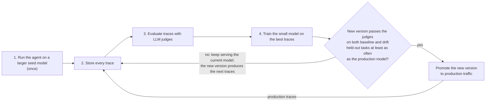

# Post-train on AI Gateway traces

A self-training loop for a small open model, inside one Snowflake account. A [LangGraph](https://docs.langchain.com/oss/python/langgraph/overview) agent runs on [Qwen3-8B](https://huggingface.co/Qwen/Qwen3-8B). [TruLens](https://www.trulens.org/) traces every run and scores it with reference-free LLM judges, and the spans and eval spans land in [`AGENT_TRACE_TABLE`](https://docs.snowflake.com/en/user-guide/snowflake-cortex/cortex-ai-gateway/observability) through [Cortex AI Gateway](https://docs.snowflake.com/en/user-guide/snowflake-cortex/cortex-ai-gateway). SQL selects the runs the judges scored well, and [Cortex Training](https://docs.snowflake.com/en/user-guide/snowflake-cortex/cortex-training) trains the next version of the model on them. Traces, scores and training data stay in the account.



The seed model (glm-5.3, through the gateway) answers the baseline training tasks once. Qwen3-8B v1 trains on its judge-approved traces. Every later version is trained on the seed traces plus the judge-approved runs of the versions before it. No reference answer is used to choose training data or to decide which version to promote.

## Result

Held-out tasks, 2 runs each. After v1 was trained, four task types it had never seen were added (the drift tasks); no seed traces exist for them. Judge pass rate is the share of runs that meet every cutoff in `TRAINING_SET_JUDGED`. Accuracy against the reference answers is measured only to check the judges. Both come from TruLens eval spans in `AGENT_TRACE_TABLE` ([`sql/07_judge_results.sql`](sql/07_judge_results.sql)). An errored run counts as a failure in the pass rate and is left out of accuracy. 28 of glm-5.3's held-out runs first failed on Cortex rate limits (HTTP 429); they were rerun as `glm-eval-v2-retry` (`batch_run.py --rerun-errors-of glm-eval-v2`), and the glm-5.3 row uses the reruns in their place.

| Model | Judge pass: baseline | Judge pass: drift | Judge pass: overall | Accuracy: baseline | Accuracy: drift | Accuracy: overall |
|---|---|---|---|---|---|---|
| glm-5.3 (seed) | 84.7% | 86.7% | 85.4% | 98.0% | 96.7% | 97.5% |
| Qwen3-8B v1 | 62.2% | 13.3% | 43.7% | 89.6% | 34.5% | 68.8% |
| Qwen3-8B v2 | 72.4% | 45.0% | 62.0% | 88.5% | 76.7% | 84.0% |
| Qwen3-8B v3 | 90.8% | 76.7% | 85.4% | 89.8% | 93.3% | 91.1% |

Base Qwen3-8B scores 13.7% on the baseline held-out tasks, which is why the loop needs a seed.

With the promotion gate, no version is promoted: v3 passes more often than glm-5.3 on baseline tasks (89 of 98 runs against 83) but less often on drift tasks (46 of 60 against 52).

Training data per version:

| Version | Trained on | Training examples (one per assistant turn) |
|---|---|---|
| v1 | 321 seed traces | 1,154 |
| v2 | 321 seed + 401 from v1 | 2,469 |
| v3 | 321 seed + 401 from v1 + 552 from v2 | 4,166 |

Each version answers the same 316 training tasks 4 times. v1 had a judge-approved run on 64 of the 130 drift training tasks, v2 on 116. Checked against the reference answers afterwards, 97.5% to 99.7% of the runs the judges kept were correct.

## How it works

- **Tracing.** `make_tee_exporter` in [`agent_lib.py`](agent_lib.py) sends each TruLens span to the local TruLens store, which feedback computation reads, and to the gateway's OTLP endpoint `<gateway>/telemetry/v1/traces`. App, tool and `eval_root`/`eval` spans land in `AGENT_TRACE_TABLE` with the gateway's own chat spans. Gateway spans carry full prompts and responses (`logging.capture_payload.request_response: true`, [`sql/01_gateway_spec.sql`](sql/01_gateway_spec.sql)) and join TruLens records on the `x-snowflake-ai-gateway-conversation-id` header.
- **Small-model runs.** Qwen3-8B is served from a Cortex Training sampling job (`--sampler JOB:CKPT`), not through the gateway, so there is no gateway payload for those runs. `make_trajectory_recorder` writes each run's messages as JSON on a plain OTel span (`agt.trajectory`), exported the same way. [`sql/05_self_trajectories.sql`](sql/05_self_trajectories.sql) builds `TRAJECTORIES` rows from it.
- **Judges.** TruLens `answer_relevance` and the trace-level agent judges `logical_consistency`, `execution_efficiency`, `tool_selection` and `tool_calling`, run by `claude-sonnet-4-6` through the TruLens Cortex provider. A `correctness` feedback compares the `FINAL ANSWER:` line with the SQL reference answer, for measurement only.
- **Selection** (`TRAINING_SET_JUDGED` in [`sql/05_self_trajectories.sql`](sql/05_self_trajectories.sql)). Train split, clean finish, `logical_consistency` = 3 of 3, relevance, tool selection and tool calling at least 2 of 3, efficiency at least 1 of 3; then the 2 runs per task with the highest mean judge score. TruLens stores 0 to 3 as 0, 0.3333, 0.6667 and 1, so the cutoffs are written as 0.66 and 0.33.
- **Training.** [`bundle/train_from_traces.py`](bundle/train_from_traces.py) renders each assistant turn as its own example with the Qwen chat template and trains a LoRA (r=32) on 8 H200s. Each version trains from base Qwen3-8B on all traces kept so far, because the SDK version used has no option to start from an earlier checkpoint.
- **Tasks.** A synthetic retail SQLite database whose business rules exist only in the system prompt (shipped orders only, net of discounts and returns). `agent_lib.suite("hard")` is the baseline set (186 train, 49 held out); `suite("hard2")` adds the drift tasks (130 train, 30 held out).

## Cost

From [`sql/08_cost.sql`](sql/08_cost.sql), at the rates in the Snowflake Service Consumption Table (effective November 9, 2026) and $2.00 per AI credit:

| | Cost |
|---|---|
| glm-5.3 through the gateway | $14.60 per 1,000 tasks |
| Qwen3-8B v3 on 4 H200s, kept busy (4,900 to 6,200 tasks an hour) | $6.15 to $7.80 per 1,000 tasks |
| Judging, one judge (claude-sonnet-4-6, blended average) | $83 per 1,000 traces |
| Training | $11 per 1,000 examples |

Producing v3 cost about $1,230 once (judging 2,952 collected runs with five judges, three training jobs, and collecting traces). If a version were promoted at v3's serving cost, about $7.60 saved per 1,000 tasks would pay that off at about 160,000 tasks, or 29 hours of traffic on the 4 H200s.

## Files

| Path | Purpose |
|---|---|
| [`agent_lib.py`](agent_lib.py) | Task suites, LangGraph agent, tee exporter, trajectory recorder, sampler-backed chat model, TruLens judges |
| [`bundle/batch_run.py`](bundle/batch_run.py) | [Code Bundle](https://docs.snowflake.com/en/sql-reference/sql/create-code-bundle) entrypoint: rollouts with TruLens and judge computation, on a gateway model or a Cortex Training sampling job |
| [`bundle/train_from_traces.py`](bundle/train_from_traces.py) | Code Bundle entrypoint: training-set view to Qwen chat format to a Cortex Training LoRA job |
| [`bundle/repair_trajectories.py`](bundle/repair_trajectories.py) | Fills tool results in `TRAJECTORIES.chat_messages` by replaying the recorded tool calls, for runs recorded before the tool-result fix |
| [`sql/01_gateway_spec.sql`](sql/01_gateway_spec.sql) | Gateway spec with client telemetry and payload capture |
| [`sql/02_external_access.sql`](sql/02_external_access.sql) | [External access integration](https://docs.snowflake.com/en/developer-guide/external-network-access/external-network-access-overview) limited to the account host |
| [`sql/03_trajectories.sql`](sql/03_trajectories.sql) | `TRAJECTORIES` from gateway payloads only (earlier version; 05 covers both) |
| [`sql/05_self_trajectories.sql`](sql/05_self_trajectories.sql) | `TRAJECTORIES` from the `agt.trajectory` span (seed and small-model runs), and the `TRAINING_SET_JUDGED` view |
| [`sql/07_judge_results.sql`](sql/07_judge_results.sql) | Held-out judge pass rate and accuracy per version; judge score distribution on collected runs |
| [`sql/08_cost.sql`](sql/08_cost.sql) | Gateway billing, judge tokens, judge evaluation count, training job sizes |
| [`sql/00_restore_gateway_spec.sql`](sql/00_restore_gateway_spec.sql) | Restores the original gateway spec |
| [`scripts/mint_pat.py`](scripts/mint_pat.py) | Role-restricted [PAT](https://docs.snowflake.com/en/user-guide/programmatic-access-tokens) into a Snowflake secret |
| [`scripts/smoke_test.py`](scripts/smoke_test.py) | One local rollout to check spans and eval spans before a batch run |

`sql/04_compare.sql`, `sql/06_compare_rounds.sql` and `scripts/deploy.py` (EVALUATION deployments, replaced here by sampling jobs) are from an earlier version of the experiment that selected training data with the reference answers.

## Run it

Prerequisites: a Snowflake account with an AI Gateway, Cortex Training, a CPU [compute pool](https://docs.snowflake.com/en/developer-guide/snowpark-container-services/working-with-compute-pool), a warehouse and a role. The scripts use `CT_QUICKSTART_USER`, `CT_QUICKSTART_DB.AGT`, `CT_QUICKSTART_CPU` and `CT_QUICKSTART_WH` with the CLI connection `DEVREL_ENTERPRISE`; change these for your account. The `CT_QUICKSTART_DOWNLOAD_EAI` integration and the `CT_ACCOUNT_RULE` network rule come from the Cortex Training quickstart setup.

```bash
C="-c DEVREL_ENTERPRISE --role CT_QUICKSTART_USER --database CT_QUICKSTART_DB --schema AGT --warehouse CT_QUICKSTART_WH"

# Setup: gateway logging, PAT secret, external access, bundles
snow sql -c DEVREL_ENTERPRISE -f sql/01_gateway_spec.sql
uv run scripts/mint_pat.py
snow sql -c DEVREL_ENTERPRISE -f sql/02_external_access.sql
cp agent_lib.py bundle/
snow bundle create AGT_BATCH --source bundle --overwrite $C
snow bundle create AGT_TRAIN --source bundle --overwrite $C

# Step 1: seed runs on the baseline training tasks (glm-5.3 via the gateway)
snow bundle execute AGT_BATCH --entrypoint batch_run.py --async $C -- \
  --suite hard --run-tag glm-seed-v2 --splits train --rollouts 3 --workers 4
snow sql -c DEVREL_ENTERPRISE -f sql/05_self_trajectories.sql     # set RUN_TAG = 'glm-seed-v2'

# Step 4: train v1 on the judge-selected seed traces (all 8 GPUs must be free)
snow bundle execute AGT_TRAIN --entrypoint train_from_traces.py --async $C -- \
  --run-tag jt-glm --source-run-tag glm-seed-v2 --view TRAINING_SET_JUDGED --suite hard2

# Steps 2-3: serve the new version from a sampling job, collect and judge its runs on all training tasks
snow bundle execute AGT_BATCH --entrypoint batch_run.py --async $C -- \
  --suite hard2 --run-tag jglm-prod --splits train --rollouts 4 --workers 12 --sampler <JOB_ID>:<CHECKPOINT_ID>
snow sql -c DEVREL_ENTERPRISE -f sql/05_self_trajectories.sql     # set RUN_TAG = 'jglm-prod'

# Gate: judge the new version on held-out tasks
snow bundle execute AGT_BATCH --entrypoint batch_run.py --async $C -- \
  --suite hard2 --run-tag jglm-eval --splits heldout --rollouts 2 --workers 12 --sampler <JOB_ID>:<CHECKPOINT_ID>

# Step 4 again: train the next version on everything kept so far, then repeat
snow bundle execute AGT_TRAIN --entrypoint train_from_traces.py --async $C -- \
  --run-tag jt-own1 --source-run-tag glm-seed-v2,jglm-prod --view TRAINING_SET_JUDGED --suite hard2

snow sql -c DEVREL_ENTERPRISE -f sql/07_judge_results.sql
snow sql -c DEVREL_ENTERPRISE -f sql/08_cost.sql
```

Progress for any run: [`scripts/watch.sh`](scripts/watch.sh) `<query_id> <run_tag>` (bundle output goes to `AGT.RUN_LOG`).

## Notes

- `batch_run.py --sampler` starts a Cortex Training sampling job on the checkpoint and cancels it when the run ends. Sampling jobs hold their GPUs until cancelled.
- [`traceparent`](https://www.w3.org/TR/trace-context/) propagation through langchain-openai did not join client and gateway spans under one `trace_id`, so they are correlated by conversation id.
- Call the gateway on the `<org>-<account>.snowflakecomputing.com` host. The `<org>-<account_name>` host that `SHOW AI GATEWAYS` returns fails Python TLS hostname checks when the account name contains an underscore.
- Payload capture stores full prompts and responses in the event table. The tasks here are synthetic.
- The seed model's provider terms may restrict training other models on its outputs. Every version keeps the seed traces in its training data; the data added after v1 is the small model's own outputs.

## Cleanup

[`sql/00_restore_gateway_spec.sql`](sql/00_restore_gateway_spec.sql) restores the original gateway spec. Cancel any sampling jobs, remove the PAT (needs a non-PAT session), and suspend the pool and warehouse.

## Resources

- [Cortex AI Gateway](https://docs.snowflake.com/en/user-guide/snowflake-cortex/cortex-ai-gateway) and [its observability and `AGENT_TRACE_TABLE`](https://docs.snowflake.com/en/user-guide/snowflake-cortex/cortex-ai-gateway/observability)
- [Cortex Training](https://docs.snowflake.com/en/user-guide/snowflake-cortex/cortex-training) and the [Cortex Training SDK](https://github.com/snowflakedb/cortex-training)
- [TruLens](https://www.trulens.org/) ([GitHub](https://github.com/truera/trulens))
- [LangGraph](https://docs.langchain.com/oss/python/langgraph/overview)
- [CREATE CODE BUNDLE](https://docs.snowflake.com/en/sql-reference/sql/create-code-bundle) and [EXECUTE CODE BUNDLE](https://docs.snowflake.com/en/sql-reference/sql/execute-code-bundle)
- [Qwen3-8B model card](https://huggingface.co/Qwen/Qwen3-8B)
