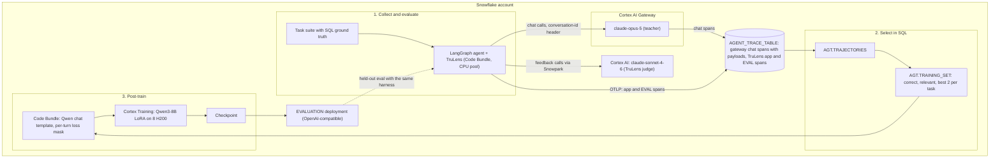

# Post-train on AI Gateway traces

Continual learning for a small open model, from its own production traces, inside Snowflake. A [LangGraph](https://docs.langchain.com/oss/python/langgraph/overview) agent runs on [Qwen3-8B](https://huggingface.co/Qwen/Qwen3-8B) served by [Cortex Training](https://docs.snowflake.com/en/user-guide/snowflake-cortex/cortex-training). [TruLens](https://www.trulens.org/) scores every run, and its spans and eval spans land in [`AGENT_TRACE_TABLE`](https://docs.snowflake.com/en/user-guide/snowflake-cortex/cortex-ai-gateway/observability) through [Cortex AI Gateway](https://docs.snowflake.com/en/user-guide/snowflake-cortex/cortex-ai-gateway). SQL selects the runs that passed the evals, and Cortex Training retrains the model on them. Each round, the deployed model gets better at the work it is given. Trace data stays in the Snowflake account.

The loop starts from a seed set: a frontier model ([Claude Opus](https://www.anthropic.com/claude)) answering the round-1 tasks through the gateway. After that, the model learns only from its own traces.

## Result

Held-out tasks, 2 rollouts each, same agent harness and same TruLens evaluators for every model. Numbers come from TruLens eval spans in `AGENT_TRACE_TABLE` ([`sql/06_compare_rounds.sql`](sql/06_compare_rounds.sql)).

After round 1, four new question kinds were added to the traffic. The round-1 model had never seen them; they stand in for what changes after an agent ships.

| Model | Round-1 kinds (98 rollouts) | New kinds (60 rollouts) | Training data |
|---|---|---|---|
| claude-opus-5 | 100.0% | 100.0% | |
| Qwen3-8B base | 13.7% | | |
| Round 1 | 95.9% | 25.0% | 372 Opus seed trajectories |
| Round 2 | 92.9% | 58.3% | seed + 488 of its own trajectories |
| Round 3 | 98.0% | 98.3% | seed + 488 + 591 of its own trajectories |

### Where each round's training data came from

| Round | Model that produced the traces | Traffic it ran | Rollouts | Clean finish | Correct | Correct and relevant | Kept (≤2 per task) | Tasks covered |
|---|---|---|---|---|---|---|---|---|
| 1 (seed) | claude-opus-5 via AI Gateway | 186 round-1-kind train tasks × 3 | 558 | 558 | 558 | 554 | 372 | 186 |
| 2 | round-1 Qwen checkpoint | 316 train tasks (186 old + 130 new) × 4 | 1,262 | 1,262 | 870 | 837 | 488 | 265 (79 new) |
| 3 | round-2 Qwen checkpoint | same 316 × 4 | 1,263 | 1,263 | 1,062 | 1,031 | 591 | 306 (120 new) |

The model for round N trains from base on the seed plus everything kept in earlier rounds: round 2 on 372 + 488 trajectories (2,471 per-turn examples), round 3 on 372 + 488 + 591 (4,273). Held-out tasks are never used for training. No new-kind example came from Opus.

How a run is chosen ([`sql/03_trajectories.sql`](sql/03_trajectories.sql), [`sql/05_self_trajectories.sql`](sql/05_self_trajectories.sql)):

1. **Train split only.** Tasks are assigned to train or held out by a hash of the task id.
2. **Clean finish.** The run ends with a final assistant message, with no pending tool call and no HTTP error.
3. **`correctness` = 1.** A TruLens feedback that checks the `FINAL ANSWER:` line against SQL ground truth: case-insensitive exact match for names, within 0.011 for numbers.
4. **`answer_relevance` ≥ 0.67.** TruLens `relevance_with_cot_reasons`, judged by claude-sonnet-4-6 through the Cortex provider, on a scale of 0 to 1. 0.67 is the middle of the judge's scale, chosen up front and not tuned.
5. **Best 2 per task.** Rank by relevance, then by fewer model calls, then by fewer output tokens. The cap stops easy tasks, which pass all 4 attempts, from crowding out hard ones.

Both scores are read from TruLens `eval_root` spans in `AGENT_TRACE_TABLE`, joined to the run by `ai.observability.eval.target_record_id`.

How the rounds were run:
- Every round retrains LoRA r=32 from base Qwen3-8B on the accumulated pool, because the SDK used here has no option to start a training job from an earlier checkpoint.
- Correctness is checked against SQL ground truth, which a real deployment would not have. Swap in your own evals, such as task success signals, user feedback or an LLM judge.
- Synthetic task families, one run per round, no hyperparameter search. The round-1 checkpoint scored 90.8% on the round-1 kinds in an earlier evaluation of the same held-out tasks ([`sql/04_compare.sql`](sql/04_compare.sql)). That is a sense of the run-to-run variance at this sample size.

### Round 1 alone (frontier seed)

| Model | Correct | Answer relevance | Median latency | Avg tool calls |
|---|---|---|---|---|
| claude-opus-5 | 100.0% | 0.997 | 10.8 s | 2.71 |
| Qwen3-8B base | 13.7% | 0.708 | 2.8 s | 4.97 |
| Qwen3-8B round 1 | 90.8% | 0.968 | 2.8 s | 2.41 |

372 Opus trajectories (2 per train task, 186 tasks), split into 1,031 per-turn examples. 2 epochs, 258 steps, loss 1.74 to about 0.11.

## How it works



- TruLens normally exports to its own store. `make_tee_exporter` in [`agent_lib.py`](agent_lib.py) sends each span to both the local TruLens store, which feedback computation reads, and the gateway's OTLP endpoint `<gateway>/telemetry/v1/traces` ([send client traces to the gateway](https://docs.snowflake.com/en/user-guide/snowflake-cortex/cortex-ai-gateway/observability)). App spans, tool spans and `eval_root`/`eval` spans land in `AGENT_TRACE_TABLE`, which uses the standard [event table columns](https://docs.snowflake.com/en/developer-guide/logging-tracing/event-table-columns).
- Gateway chat spans carry the full prompts and responses (`logging.capture_payload.request_response: true`, set in [`sql/01_gateway_spec.sql`](sql/01_gateway_spec.sql)). The last chat span of a conversation holds the whole trajectory as [OpenTelemetry GenAI semantic convention](https://opentelemetry.io/docs/specs/semconv/gen-ai/) message parts.
- Gateway spans join TruLens records on the `x-snowflake-ai-gateway-conversation-id` header. The same id is passed in the LangGraph `config` metadata and recorded on the TruLens `record_root` span. Eval spans join on `ai.observability.eval.target_record_id`. The joins are in [`sql/03_trajectories.sql`](sql/03_trajectories.sql).
- Feedbacks: `correctness`, which checks the final answer against SQL ground truth in code, and `answer_relevance`, judged by `claude-sonnet-4-6` through the TruLens Cortex provider. Snowflake's own TruLens integration is described in [AI Observability](https://docs.snowflake.com/en/user-guide/snowflake-cortex/ai-observability).
- The task suite (`agent_lib.suite("hard")`) is a synthetic retail-finance SQLite database whose business rules exist only in the system prompt (shipped orders only, net of discounts and returns, region from the customer). Base Qwen3-8B scores 94% on the simpler `basic` suite, so `hard` is the one used for the comparison.

## Files

| Path | Purpose |
|---|---|
| [`agent_lib.py`](agent_lib.py) | Task suites, LangGraph agent (gateway, or a Cortex Training deployment), tee exporter, TruLens feedbacks |
| [`bundle/batch_run.py`](bundle/batch_run.py) | [Code Bundle](https://docs.snowflake.com/en/sql-reference/sql/create-code-bundle) entrypoint: rollouts with TruLens, feedback computation, run index in `AGT.ROLLOUT_INDEX` |
| [`bundle/train_from_traces.py`](bundle/train_from_traces.py) | Code Bundle entrypoint: `TRAINING_SET` to Qwen chat format to Cortex Training LoRA, then a weights-only checkpoint |
| [`sql/01_gateway_spec.sql`](sql/01_gateway_spec.sql) | Gateway spec with client telemetry and payload capture |
| [`sql/02_external_access.sql`](sql/02_external_access.sql) | [External access integration](https://docs.snowflake.com/en/developer-guide/external-network-access/external-network-access-overview) limited to the account host |
| [`sql/03_trajectories.sql`](sql/03_trajectories.sql) | `TRAJECTORIES`, `TRAINING_FUNNEL`, `TRAINING_SET` built from `AGENT_TRACE_TABLE` |
| [`sql/04_compare.sql`](sql/04_compare.sql) | Round-1 comparison from TruLens eval spans |
| [`sql/05_self_trajectories.sql`](sql/05_self_trajectories.sql) | Trajectories from the deployed model's own runs (TruLens `agt.trajectory` span), same selection rules |
| [`sql/06_compare_rounds.sql`](sql/06_compare_rounds.sql) | Held-out correctness by round, round-1 kinds vs new kinds |
| [`scripts/mint_pat.py`](scripts/mint_pat.py) | Role-restricted [PAT](https://docs.snowflake.com/en/user-guide/programmatic-access-tokens) into a Snowflake secret, using a temporary key pair |
| [`scripts/deploy.py`](scripts/deploy.py) | Create or drop a Cortex Training EVALUATION deployment (base model or checkpoint) |
| [`scripts/smoke_test.py`](scripts/smoke_test.py) | One local rollout to check spans and eval spans before the batch run |

## Run it

Prerequisites: a Snowflake account with an AI Gateway, Cortex Training enabled (including model deployments), a CPU [compute pool](https://docs.snowflake.com/en/developer-guide/snowpark-container-services/working-with-compute-pool), a warehouse, and a role. The scripts use `CT_QUICKSTART_USER`, `CT_QUICKSTART_DB.AGT`, `CT_QUICKSTART_CPU` (3 nodes) and `CT_QUICKSTART_WH`, with the CLI connection `DEVREL_ENTERPRISE`; change these for your account. The `CT_QUICKSTART_DOWNLOAD_EAI` integration (PyPI, GitHub, Hugging Face) and the `CT_ACCOUNT_RULE` network rule come from the Cortex Training quickstart setup.

```bash
C="-c DEVREL_ENTERPRISE --role CT_QUICKSTART_USER --database CT_QUICKSTART_DB --schema AGT --warehouse CT_QUICKSTART_WH"

# 1. Gateway logging, PAT secret, external access
snow sql -c DEVREL_ENTERPRISE -f sql/01_gateway_spec.sql
uv run scripts/mint_pat.py
snow sql -c DEVREL_ENTERPRISE -f sql/02_external_access.sql

# 2. Bundles (agent_lib.py is copied in at build time)
cp agent_lib.py bundle/
snow bundle create AGT_BATCH --source bundle --overwrite $C
snow bundle create AGT_TRAIN --source bundle --overwrite $C

# 3. Teacher traces on the train split
snow bundle execute AGT_BATCH --entrypoint batch_run.py --async $C -- \
  --suite hard --run-tag hard-opus-train-v2 --splits train --rollouts 3 --workers 10

# 4. Select trajectories (set RUN_TAG in the file)
snow sql -c DEVREL_ENTERPRISE -f sql/03_trajectories.sql

# 5. Train (all 8 GPUs must be free)
snow bundle execute AGT_TRAIN --entrypoint train_from_traces.py --async $C -- \
  --run-tag train-hard-v1 --source-run-tag hard-opus-train-v2 --suite hard --epochs 2 --batch-size 8 --lr 1e-4

# 6. Evaluate base, tuned and teacher on the held-out split
uv run scripts/deploy.py base                      # or: checkpoint <JOB_ID> <CHECKPOINT_ID>
snow bundle execute AGT_BATCH --entrypoint batch_run.py --async $C -- \
  --suite hard --run-tag hard-final-qwen-tuned --splits heldout --rollouts 2 --workers 8 \
  --model <DEPLOYMENT_ID> --base-url https://<account-host>/api/v2/databases/CT_QUICKSTART_DB/schemas/LAB/cortex-training/inference/v1
snow sql -c DEVREL_ENTERPRISE -f sql/04_compare.sql
uv run scripts/deploy.py drop <DEPLOYMENT_ID>

# 7. Continual rounds on the deployed model's own traces (suite hard2 adds new question kinds)
snow bundle execute AGT_BATCH --entrypoint batch_run.py --async $C -- \
  --suite hard2 --run-tag r1-prod --splits train --rollouts 4 --workers 12 --model <DEPLOYMENT_ID> --base-url <BASE_URL>
snow sql -c DEVREL_ENTERPRISE -f sql/05_self_trajectories.sql      # set RUN_TAG = 'r1-prod'
snow bundle execute AGT_TRAIN --entrypoint train_from_traces.py --async $C -- \
  --run-tag train-r2 --source-run-tag hard-opus-train-v2,r1-prod --suite hard2
# deploy the new checkpoint, evaluate with --splits heldout --run-tag r2-eval, repeat
snow sql -c DEVREL_ENTERPRISE -f sql/06_compare_rounds.sql
```

Progress for any run: [`scripts/watch.sh`](scripts/watch.sh) `<query_id> <run_tag>` (bundle output goes to `AGT.RUN_LOG`). Bundles run with [`EXECUTE CODE BUNDLE`](https://docs.snowflake.com/en/sql-reference/sql/execute-code-bundle) under the hood.

## Notes and limits

- [`traceparent`](https://www.w3.org/TR/trace-context/) propagation through langchain-openai did not join client and gateway spans under one `trace_id`, so they are correlated by conversation id.
- Calls to a Cortex Training deployment do not go through the gateway, so there are no gateway chat payloads for them. The harness records each run's messages as JSON on a TruLens span (`agt.trajectory`), which is exported to `AGENT_TRACE_TABLE` with the other spans.
- Cortex Training deployments are EVALUATION class. They hold their GPUs until dropped. The deployment API is in the [Cortex Training SDK](https://github.com/snowflakedb/cortex-training).
- Call the gateway on the `<org>-<account>.snowflakecomputing.com` host. The `<org>-<account_name>` host that `SHOW AI GATEWAYS` returns fails Python TLS hostname checks when the account name contains an underscore.
- Qwen3's chat template renders past assistant turns without the empty `<think></think>` block, so training uses one example per assistant turn, rendered exactly as the model sees it at that step.
- Payload capture stores full prompts and responses in the event table. The tasks here are synthetic.
- The seed model's provider terms may restrict training other models on its outputs. Check them before publishing a model trained this way; `agent_lib.TEACHER_MODEL` can be any gateway model, for example `glm-5.3`. Rounds after the seed use only the model's own outputs.

## Cleanup

[`sql/00_restore_gateway_spec.sql`](sql/00_restore_gateway_spec.sql) restores the original gateway spec. Drop deployments with `scripts/deploy.py drop`, remove the PAT (needs a non-PAT session), and suspend the pool and warehouse.

## Resources

- [Cortex AI Gateway](https://docs.snowflake.com/en/user-guide/snowflake-cortex/cortex-ai-gateway) and [its observability and `AGENT_TRACE_TABLE`](https://docs.snowflake.com/en/user-guide/snowflake-cortex/cortex-ai-gateway/observability)
- [Cortex Training](https://docs.snowflake.com/en/user-guide/snowflake-cortex/cortex-training) and the [Cortex Training SDK](https://github.com/snowflakedb/cortex-training)
- [AI Observability with Snowflake Cortex](https://docs.snowflake.com/en/user-guide/snowflake-cortex/ai-observability)
- [TruLens](https://www.trulens.org/) ([GitHub](https://github.com/truera/trulens))
- [LangGraph](https://docs.langchain.com/oss/python/langgraph/overview)
- [CREATE CODE BUNDLE](https://docs.snowflake.com/en/sql-reference/sql/create-code-bundle) and [EXECUTE CODE BUNDLE](https://docs.snowflake.com/en/sql-reference/sql/execute-code-bundle)
- [OpenTelemetry GenAI semantic conventions](https://opentelemetry.io/docs/specs/semconv/gen-ai/)
- [Qwen3-8B model card](https://huggingface.co/Qwen/Qwen3-8B)
